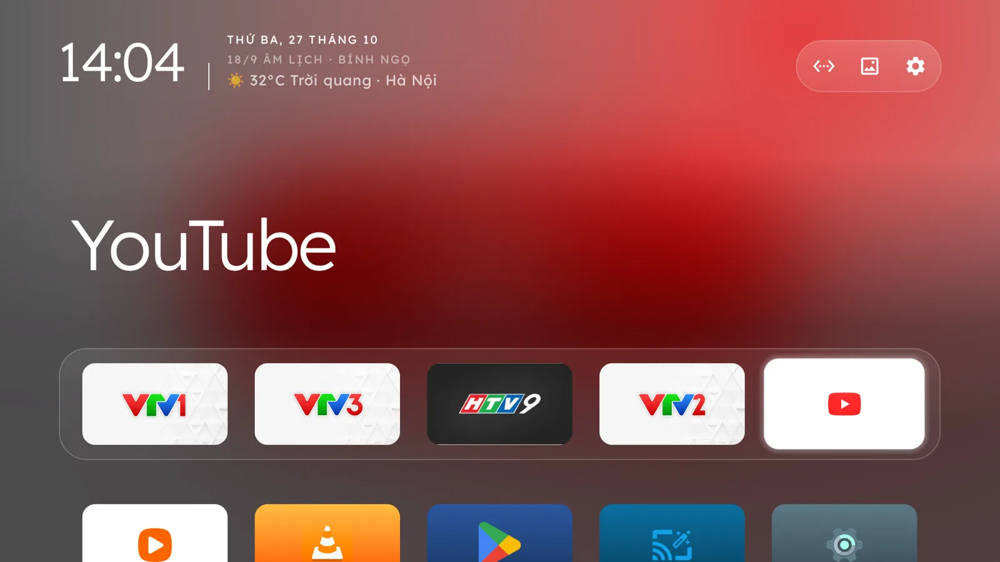
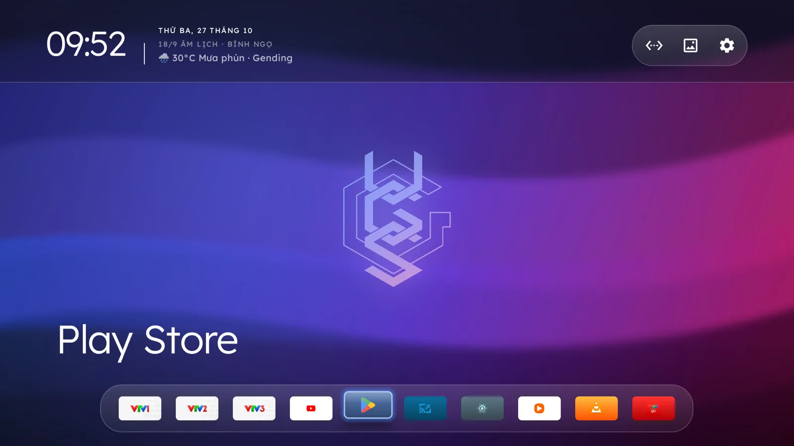
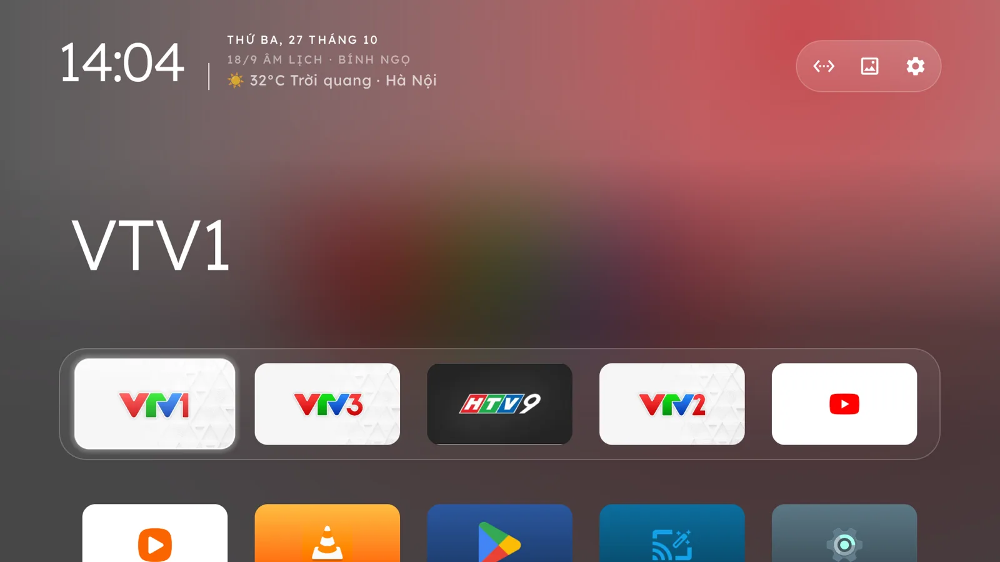
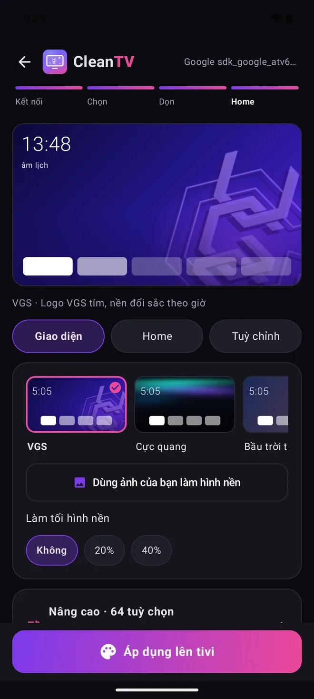
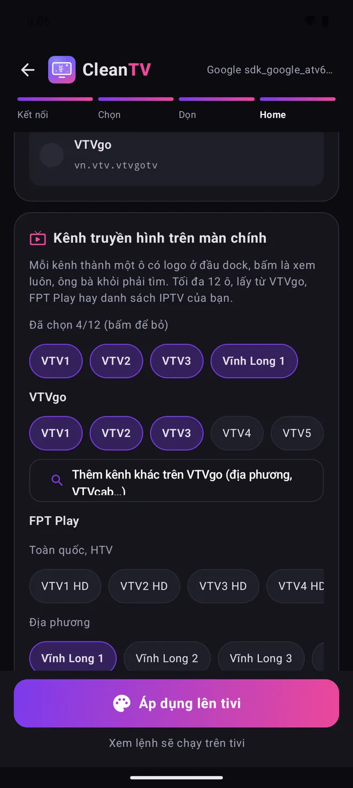
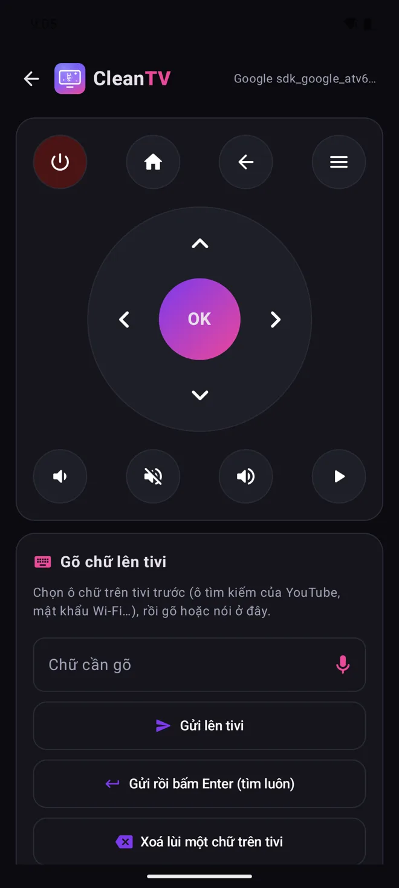

# CleanTV by VGS

**Tivi hết quảng cáo.** App Android dọn quảng cáo, theo dõi và app rác của hãng trên Android TV / Google TV qua Wi-Fi, rồi thay màn Home đầy quảng cáo bằng một Home sạch. Không root, không gỡ gì (chỉ tắt), khôi phục một chạm.

**No more TV ads.** An Android app that switches off the maker's ads, tracking and junk on Android TV / Google TV over Wi-Fi and swaps the ad-filled Home for a clean one. No root, nothing uninstalled (only disabled), one-tap restore.

[Tải APK / Download](https://vgs.zone/cleantv) · [English page](https://cleantv.alexvgs.tech/en) · [Nhật ký cập nhật / Changelog](https://vgs.zone/cleantv#cap-nhat) · [Góp ý / Feedback](https://vgs.zone/gop-y)

<p>
  
  
</p>
<p>
  
  
  
</p>
<p>
  
  
  
  
  
</p>

---

## Tiếng Việt

### App làm gì
**Dọn tivi**
- **Kết nối tivi qua Wi-Fi** bằng ADB: quét mạng hoặc gõ IP. Google TV đời mới thì ghép bằng mã 6 số (Gỡ lỗi không dây), app tự dò cổng. Trong app có hướng dẫn 7 bước kèm hình.
- **So với 341 danh sách đã thử** của cộng đồng CleanYourTV (95 hãng: TCL, Sony, Xiaomi, Philips, Hisense, Skyworth, onn, Chromecast, hộp FPT / VNPT, máy chiếu…). Chưa khớp mẫu thì app gợi ý mẫu gần giống, tivi lạ thì dùng luật chung an toàn.
- **Chỉ tắt, không gỡ** quảng cáo, theo dõi, app rác. App không đụng cổng HDMI, remote, bàn phím, CH Play, gói đang giữ Wi-Fi, gói lõi Android và Home đang dùng. Google Home / cast và tìm kiếm giọng nói không bao giờ được tích sẵn.
- Gói nhiều người dùng cùng mẫu giữ lại thì app hỏi lại trước khi tắt. Lỡ tắt nhầm thì vào "Bật lại từng app": app đọc thẳng từ tivi, kể cả khi không còn bản sao lưu.
- App cảnh báo khi kết nối nhầm vào điện thoại hoặc máy tính bảng, và báo khi giờ tivi lệch giờ điện thoại (Xiaomi bản Trung Quốc).

**Home sạch** (launcher CleanYourTV, bản vá VGS)
- **27 giao diện phong phú**: VGS, Kiểu Apple TV, Kiểu macOS, Cực quang, Bầu trời theo giờ, Điện ảnh, Kính mờ, Thu Phần Lan, Phong cảnh, Thụy Điển, Tối giản, Nhiều app, Neon Đêm, Tinh Vân, Thiền Trà, Sa Mạc, Ngọc Bích, Điện Ảnh Noir, Hoàng Hôn Pastel, Đại Dương Sâu, Retro Synthwave, Băng Giá, Điện Ảnh Top Shelf, Lưới Đa Năng 7 cột, Google TV Tinh Gọn, Bầu Trời Hoàng Kim, Trung Tâm Chỉ Huy HUD, Thung Lũng Tĩnh Tại.
- Đồng hồ, **lịch âm có can chi**, thời tiết theo 3.321 phường/xã hoặc thành phố nước ngoài, lời chào, **dock tối đa 9 app**, cụm nút Máy chiếu · Mạng · Màn hình chờ · Cài đặt, **thanh Mini Player điều khiển nhạc đang phát ngầm** (MediaSession: Spotify, YouTube Music, Zing MP3...) và nút Đang phát.
- **Bộ Widget thông minh phong cách Samsung The Frame**: Thời tiết góc trên nút cài đặt, Dải thẻ sự kiện & đếm ngược Tết / Rằm / Mùng 1, Khối Hôm nay (Danh ngôn & sự kiện Ngày này năm xưa), Khối Thời tiết & Dự báo 4 ngày kèm AQI, Tự động xoay carousel nội dung.
- **Ảnh nền riêng** chọn từ điện thoại, từ tivi hay USB. Có thể để vừa khung không cắt, hoặc tối đa 20 ảnh tự đổi. Có màn chờ động: đồng hồ hiện trên ảnh nền trôi chậm.
- **Kênh truyền hình ngay trên màn chính**: Mọi kênh VTVgo, 61 kênh FPT Play chọn sẵn hoặc link chia sẻ, 101 kênh TV360 (Viettel), danh sách IPTV m3u (mở bằng VLC, MX Player, Kodi). Tối đa 16 ô có logo, bấm là xem.
- Tuỳ chỉnh không cần biết kỹ thuật:
  - Bố cục: dock tối đa 9 app, số app mỗi hàng, vị trí hàng app, tất cả app một hàng, ô icon đều nhau, dải nền thanh dock độc lập, icon to trong ô app.
  - Chữ: cỡ chữ và màu chữ đồng hồ / ngày / thời tiết, chữ trắng sáng, nút Wi-Fi / Cài đặt sát mép trên.
  - Nút trên Home: nút hẹn giờ tắt tivi, mở một app khi bật tivi, thư viện app trong menu Cài đặt.
  - Thêm hơn 90 tuỳ chọn Nâng cao. Lưu cả bộ cài đặt ra file để mang sang tivi khác.
- **Nút Home về đúng Home sạch**: app bấm thử nút Home thật. Tivi không cho tắt Home gốc (Google TV còn trình cài đặt, TCL, hộp nhà mạng) thì Home sạch tự mở đè lên, không phải quên Wi-Fi. Rút điện bật lại Home sạch cũng tự lên; tìm giọng nói Google TV vẫn hiện kết quả.
- **Nút trên remote vẫn chạy**: YouTube, Netflix, Prime, bánh răng Cài đặt chạy theo bảng phím của từng mẫu tivi. "Dò một nút" thì gán nút lạ (VTVgo, FPT Play…) cho app tuỳ chọn. Giữ nút âm lượng vẫn tăng giảm liên tục.
- Máy chiếu (Formovie, XGIMI, JMGO…): ghim màn lấy nét / chỉnh hình vào nút Máy chiếu. Xiaomi bản Trung Quốc có Home sạch riêng (hiện tiếng Việt). Bo mạch CVTE thì giữ Home của hãng.

**Remote trên điện thoại**
- Phím điều hướng, OK, Home, quay lại, âm lượng, nguồn. Gõ hoặc nói để điền chữ vào ô đang chọn trên tivi, có dấu tiếng Việt.
- Hẹn giờ tắt tivi 15–120 phút; tivi tự đếm nên đóng app vẫn tắt đúng hẹn.
- Mở, gỡ app trên tivi. Cài file APK từ điện thoại sang tivi.

**An toàn**
- **Sao lưu trước mọi thay đổi**, trên điện thoại và trên tivi. Khôi phục một chạm, đổi điện thoại vẫn khôi phục được.
- **Tivi tự canh gác**: đang thay Home mà rớt Wi-Fi, hết pin hay tắt app thì 3 phút sau tivi tự bật lại Home gốc.
- **Kịch bản khôi phục** cho máy tính (file lệnh adb chạy trên Windows / Mac / Linux), **xem trước lệnh** sẽ chạy trên tivi.
- Xong việc, app hỏi tắt ADB (an toàn hơn) hay giữ để lần sau chỉnh tiếp. Rời app mà chưa chọn thì tivi tự tắt ADB.

**Còn nữa**
- **Khoá trẻ em**: hẹn giờ khoá tivi theo ngày trong tuần, mã PIN 4 số mở 60 phút, che cả HDMI và chặn remote.
- DNS chặn quảng cáo AdGuard (tuỳ chọn), xem màn hình tivi trên điện thoại, nhớ danh sách tivi đã dọn, dòng RAM / ROM của tivi.
- Chạy trên **điện thoại Android** hoặc **ngay trên tivi** (cho người dùng iPhone). Tự cập nhật, song ngữ Việt / Anh.
- Tivi chưa chạy đúng thì bấm **"Gửi danh sách gói cho VGS"**: gửi model, các gói đang tắt và vài dòng chẩn đoán Home để sửa cho đúng mẫu.

### Dựng từ mã nguồn
Cần JDK 17 và Android SDK (compileSdk 35).

```bash
scripts/dung-launcher.sh          # tải CleanYourTV, áp patches/launcher-vgs.patch, dựng Home sạch + dữ liệu 341 mẫu vào assets
./gradlew assembleRelease         # thiếu ky.properties thì APK ký bằng khoá debug
./gradlew :app:testReleaseUnitTest
```

`app/src/main/assets/tvhome.apk` và `du-lieu.json` đã có sẵn trong repo, nên chỉ dựng app thì không cần bước đầu.

### Kiểm tra bản tải về
Mọi APK trên [Releases](https://github.com/vgscity/vgs-cleantv/releases) và vgs.zone/cleantv đều ký bằng cùng một khoá. Dấu SHA-256 của chứng chỉ:

```
ab94764d40109789e5448ab6539ed960bafb2e5c51c4a8ebd100e524ad8b3046
```

```bash
apksigner verify --print-certs CleanTV-x.y.z.apk     # phải ra đúng dấu trên
shasum -a 256 CleanTV-x.y.z.apk                       # so với file .sha256 trên Releases
scripts/so-ban-dung.sh CleanTV-x.y.z.apk              # dựng lại từ mã nguồn ở tag vx.y.z rồi so: mọi file bên trong phải trùng
```

Bản dựng tái tạo được: hai lần dựng sạch cùng mã nguồn ra cùng một APK. Bạn tự dựng thì ký bằng khoá của bạn, nên `so-ban-dung.sh` so từng file bên trong (kể cả `khoa.apk` lồng trong) và bỏ qua chữ ký.

### Cấu trúc
| Thư mục | Nội dung |
|---|---|
| `app/` | App (Kotlin + Jetpack Compose). Package `zone.vgs.cleantv.manager`, mã ở `zone.vgs.tvsach` (tên biến tiếng Việt) |
| `app/.../adb/` | Kết nối ADB (libadb-android), các thao tác trên tivi: sao lưu, tắt gói, cài Home sạch, thử nút Home, khôi phục |
| `app/.../dulieu/` | Danh sách mẫu tivi, luật chọn gói (`KeHoach.kt`), theme, hướng dẫn |
| `patches/launcher-vgs.patch` | Phần VGS sửa trên launcher CleanYourTV (thời tiết, font Lexend, cụm nút, máy chiếu, màn chờ…) |
| `khoa/` | App nhỏ "Khoá trẻ em" cài lên tivi (dịch vụ trợ năng che màn hình theo giờ, mở bằng mã PIN) |
| `scripts/` | Dựng launcher, dựng dữ liệu mẫu tivi, phát hành, so bản dựng (`so-ban-dung.sh`) |
| `dem/` | Cloudflare Worker đếm ẩn danh (lượt tải, lượt dùng) |
| `web/` | Trang tiếng Anh, file cập nhật (`cap-nhat.json`), nhật ký (`nhat-ky.json`) |

### Dữ liệu thu thập
Chỉ số liệu ẩn danh: một mã máy ngẫu nhiên do app tự sinh, số bản app, tên mẫu tivi, số gói đã tắt, gửi khi mở app (mỗi ngày một lần), cập nhật, dọn xong, cài Home sạch. **Không** gửi email, tên, danh sách app, IP hay vị trí. Riêng nút "Gửi danh sách gói cho VGS" ở màn cuối chỉ chạy khi bạn tự bấm (model tivi, các gói đang tắt, đánh giá, ghi chú). Xem `app/src/main/java/zone/vgs/tvsach/Dem.kt` và `dem/src/index.js`.

### Đóng góp
Báo lỗi, xin hỗ trợ tivi mới: [vgs.zone/gop-y](https://vgs.zone/gop-y) (mục "App CleanTV") hoặc mở Issue. Danh sách tivi mới nên gửi thẳng cho [CleanYourTV](https://github.com/Gathin23/cleanyourtv) để mọi người cùng dùng; CleanTV tự lấy về.

---

## English

### What it does
**Cleaning**
- **Connects over Wi-Fi** with ADB: scan or type the IP. Newer Google TVs pair with a 6-digit code and the app finds the port. A 7-step picture guide is built in.
- **Matches 341 tested lists** from the CleanYourTV community (95 brands). It suggests close models when yours isn't listed, and unknown TVs get safe general rules.
- **Disables, never uninstalls** ads, tracking and junk. Leaves HDMI inputs, the remote, keyboards, Play Store, the Wi-Fi owner, core Android packages and the Home in use alone. Google Home / casting and voice search are never pre-ticked.
- Asks again before disabling a package most owners of the same model kept. "Re-enable apps" reads what is disabled straight from the TV, even without a backup.
- Warns when it is connected to a phone or tablet instead of a TV, and when the TV's clock is off from the phone's.

**Clean Home** (CleanYourTV launcher with VGS patches)
- **27 versatile themes**: VGS, Apple TV style, macOS style, Aurora, Sky by the hour, Cinema, Scenes, Minimal, More apps, Neon Night, Cosmic Nebula, Zen Forest, Desert Sunset, Emerald Matrix, Noir, Pastel Twilight, Ocean Abyss, Retro Synthwave, Nordic Winter, Top Shelf, Ultra Dashboard 7-Col, Google TV Pure, Sunset Gold, Tactical HUD, Cosy Valley Zen...
- Clock, **Vietnamese lunar date with Can Chi**, ward-level weather (3,321 wards) or city abroad, greeting, **9-app dock**, Projector · Network · Screensaver · Settings cluster, **Mini Player for background music playback** (Spotify, YouTube Music, Zing MP3...) and Now playing button.
- **Samsung The Frame Style Smart Widgets**: Corner weather above settings, Event & Lunar / Tet countdown row, Today card (Daily quotes & Today in History milestones), Weather & 4-day forecast with AQI, and automatic carousel rotation.
- **Your own wallpaper** from the phone, the TV or a USB stick: fit without cropping, or up to 20 rotating pictures; an animated screensaver with the clock over a slowly drifting wallpaper.
- **TV channels on the home screen**: VTVgo, 61 ready-made FPT Play channels, 101 TV360 channels, custom m3u IPTV list (VLC, MX Player, Kodi). Up to 16 tiles with logos.
- Easy options:
  - Layout: up to 9 dock apps, apps per row, row position, one-row layout, uniform icon tiles, independent dock background band, big app icons.
  - Text: clock size and custom text color, bright white text, Wi-Fi / Settings buttons at the very top.
  - Buttons on Home: sleep-timer button, app to open at power-on, Library in Settings menu.
  - Plus 90+ Advanced options. Export the whole setup to a file for other TVs.
- **Home lands on the clean Home**: the app tests the real Home key. Where the stock Home can't be disabled (Google TV with its setup app, TCL, operator boxes) the clean Home opens over it, with no need to forget Wi-Fi. After a power cut it comes back by itself, and Google TV voice search still shows its results.
- **Remote keys keep working**: YouTube, Netflix, Prime and the Settings gear follow each model's key map. "Learn a key" binds an unknown app key to the app you pick. Holding volume still ramps.
- Projectors get focus / keystone shortcuts. Chinese Xiaomi TVs get an allowed Home build (in Vietnamese). CVTE boards keep their stock Home.

**Phone remote**
- D-pad, OK, Home, Back, volume, power; type or speak into the field focused on the TV (Vietnamese accents included).
- Sleep timer 15–120 minutes, counted on the TV so it fires with the app closed.
- Open or uninstall TV apps, and install an APK from the phone onto the TV.

**Safety**
- **Backs up before any change**, on the phone and on the TV; one-tap Restore, even from a new phone.
- **The TV guards itself**: if the connection drops while Home is being replaced, it restores its stock Home after 3 minutes.
- **Restore script** for a computer (plain adb commands for Windows / macOS / Linux) and a **command preview** before anything runs.
- At the end you choose to switch ADB off (safer) or keep it for later changes. Leave without choosing and the TV switches it off.

**Also**
- **Kids lock**: weekday lock periods, a 4-digit PIN unlocks for 60 minutes, covers HDMI and blocks the remote.
- Optional AdGuard DNS, view the TV screen on the phone, remembers every TV you cleaned, the TV's RAM / storage at a glance.
- Runs on an **Android phone** or **on the TV itself** (for iPhone users). Self-updating, Vietnamese / English.
- If a TV misbehaves, **"Send package list to VGS"** sends the model, the disabled packages and a short Home diagnosis so the fix fits that model.

### Build
JDK 17 + Android SDK (compileSdk 35): `scripts/dung-launcher.sh`, then `./gradlew assembleRelease`. Without `ky.properties` the release APK is signed with the debug key. Code identifiers are in Vietnamese.

### Verify a download
Every APK on Releases and vgs.zone/cleantv is signed with the same key, certificate SHA-256
`ab94764d40109789e5448ab6539ed960bafb2e5c51c4a8ebd100e524ad8b3046` (`apksigner verify --print-certs`). Builds are
reproducible: `scripts/so-ban-dung.sh CleanTV-x.y.z.apk` rebuilds from the matching tag and checks that every file inside
(the nested `khoa.apk` too) is identical, ignoring the signature, since yours uses your own key.

### Privacy
Anonymous counts only (a random app-generated ID, app version, TV model, number of packages disabled). No email, name, app list, IP or location. The "Send package list to VGS" button on the last screen only sends when you tap it (TV model, disabled packages, your rating and note). See `Dem.kt` and `dem/src/index.js`.

---

## Ghi công / Credits
CleanTV is built on **[CleanYourTV](https://github.com/Gathin23/cleanyourtv)** by Gathin and its contributors (MIT): the clean Home launcher and the TV lists come from that project. Also libadb-android, Conscrypt, Bouncy Castle, Lexend (OFL) and Open-Meteo weather data. See [NOTICE](NOTICE).

## Giấy phép / License
Source code: [MIT](LICENSE). The names **CleanTV** and **VGS**, the VGS and CleanTV logos and the VGS wallpaper are not covered by the licence: modified builds should use their own name and artwork.

Made by [VGS — Vietnam Gaming Setup](https://vgs.zone).
